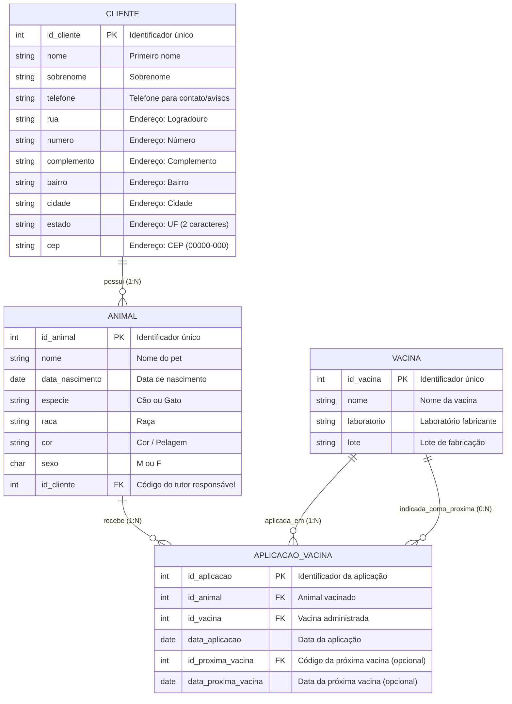

# Modelo Entidade-Relacionamento (MER)
## Sistema de Controle de Vacinação e Notificação — Clínica Veterinária

---

### Identificação do Projeto
- **Instituição:** SENAI — Serviço Nacional de Aprendizagem Industrial
- **Unidade Curricular:** Banco de Dados
- **Docente:** Prof. Tércio B. Ribeiro
- **Data da Atividade:** 17/11/2026
- **Especialidade da Clínica:** Atendimento a Cães e Gatos

---

## 1. Visão Geral e Contexto de Negócio

A clínica veterinária busca informatizar o seu sistema de controle de imunização e prontuário preventivo de cães e gatos. O objetivo central é **melhorar proativamente a notificação aos clientes** sobre a data de vencimento e o tipo de vacina a ser aplicada em seus animais, reduzindo a inadimplência vacinal e garantindo a saúde dos pets.

Para atender plenamente às regras de negócio levantadas na atividade acadêmica, o modelo foi projetado cobrindo o cadastro de clientes (tutores), os animais atendidos, o catálogo/lote de vacinas disponíveis e o histórico temporal de aplicações com agendamento da próxima dose.

---

## 2. Entidades do Domínio

O domínio foi estruturado em quatro entidades principais:

### 2.1. `CLIENTE` (Tutor)
Representa o proprietário ou tutor do animal, responsável pelo agendamento, comparecimento e decisões clínicas.
- **Identificador Único (`PK`):** Código numérico sequencial (`id_cliente`).
- **Atributos Pessoais:** Nome, Sobrenome, Telefone de contato (essencial para envio de lembretes e notificações via WhatsApp/SMS).
- **Atributo Composto (`endereco`):** No modelo conceitual, o endereço é tratado como um atributo composto, subdividido em componentes atômicos:
  - Logradouro / Rua (`rua`)
  - Número (`numero`)
  - Complemento (`complemento`)
  - Bairro (`bairro`)
  - Cidade (`cidade`)
  - Estado / Unidade Federativa (`estado`)
  - Código de Endereçamento Postal (`cep`)

### 2.2. `ANIMAL` (Paciente)
Representa o paciente da clínica (cão ou gato).
- **Identificador Único (`PK`):** Código numérico sequencial (`id_animal`).
- **Atributos Clínicos/Cadastrais:** Nome do animal, data de nascimento (ou estimada, para cálculo de idade e protocolos filhote/adulto), espécie (ex.: Canina ou Felina), raça, cor da pelagem e sexo (`M` - Macho ou `F` - Fêmea).
- **Relacionamento com Tutor (`FK`):** `id_cliente`, indicando a quem o animal pertence.

### 2.3. `VACINA` (Catálogo e Lote)
Representa as vacinas disponíveis e administradas na clínica (ex.: V8, V10, Antirrábica, Giárdia, Quádrupla Felina).
- **Identificador Único (`PK`):** Código numérico sequencial (`id_vacina`).
- **Atributos de Rastreabilidade:** Nome comercial/biológico da vacina, nome do laboratório fabricante (ex.: Zoetis, MSD, Virbac, Boehringer Ingelheim) e lote de fabricação (fundamental para vigilância sanitária e farmacovigilância veterinária).

### 2.4. `APLICACAO_VACINA` (Entidade Associativa de Histórico e Notificação)
Materializa o relacionamento muitos-para-muitos ($N:N$) entre `ANIMAL` e `VACINA`, registrando o histórico de atendimento clínico e as diretrizes do reforço preventivo.
- **Identificador Único (`PK`):** Código numérico sequencial do evento de aplicação (`id_aplicacao`).
- **Vínculos Estrangeiros (`FK`):**
  - `id_animal`: Referência ao animal que recebeu a dose.
  - `id_vacina`: Referência à vacina administrada.
  - `id_proxima_vacina`: Referência à vacina indicada para o próximo ciclo/reforço (FK recursiva/referencial para a entidade `VACINA`).
- **Atributos Temporais:**
  - `data_aplicacao`: Data exata em que a vacina foi inoculada.
  - `data_proxima_vacina`: Data calculada/prescrita para a próxima dose ou reforço anual.

> **Importância Estratégica da Notificação:**  
> Ao armazenar `id_proxima_vacina` e `data_proxima_vacina` no registro da aplicação, o sistema permite consultas preditivas simplificadas e indexadas (ex.: "listar todos os clientes cujos cães possuem reforço de vacina V10 vencendo nos próximos 15 dias"), habilitando disparos automatizados de lembretes aos tutores.

---

## 3. Relacionamentos e Cardinalidades

```
+-----------+                    +-----------+                    +--------------------+                    +-----------+
|  CLIENTE  | 1,1            0,N |  ANIMAL   | 1,1            0,N |  APLICACAO_VACINA  | 0,N            1,1 |  VACINA   |
|           |--------------------|           |--------------------| (Associativa N:N)  |--------------------|           |
+-----------+      possui        +-----------+      recebe        +--------------------+      aplicada      +-----------+
                                                                            |
                                                                            | 0,N              0,1 (reforço)
                                                                            +-----------------------+
                                                                                   indica próxima   |
                                                                                                    v
                                                                                            [ VACINA (FK) ]
```

### Detalhamento das Regras de Negócio e Cardinalidades

#### A. Relacionamento `CLIENTE` — `ANIMAL`
- **Semântica:** Um cliente é tutor/proprietário de um ou mais animais cadastrados.
- **Cardinalidade:**
  - `CLIENTE` para `ANIMAL`: **$(0, N)$** ou **$(1, N)$** — Um cliente recém-cadastrado pode possuir 1 ou mais animais vinculados.
  - `ANIMAL` para `CLIENTE`: **$(1, 1)$** — Cada animal cadastrado pertence obrigatoriamente a exatamente 1 cliente responsável.
- **Classificação:** Relacionamento binário $1:N$ (Um para Muitos). No modelo relacional, a chave primária `id_cliente` migra como Chave Estrangeira (`FK`) para a tabela `ANIMAL`.

#### B. Relacionamento `ANIMAL` — `VACINA` (Entidade Associativa `APLICACAO_VACINA`)
- **Semântica:** Um animal recebe vacinas ao longo de sua vida; uma vacina é aplicada a diversos animais.
- **Cardinalidade do Domínio:**
  - `ANIMAL` para `VACINA`: **$(0, N)$** — Um animal novo pode ainda não ter tomado vacina na clínica ou já possuir múltiplos registros.
  - `VACINA` para `ANIMAL`: **$(0, N)$** — Uma determinada vacina em estoque pode ainda não ter sido aplicada ou já ter sido aplicada em inúmeros animais.
- **Resolução Relacional:** Relacionamento de muitos-para-muitos ($N:N$). Como há dados associados ao fato (data de aplicação, próxima vacina e data do próximo reforço), cria-se a entidade associativa `APLICACAO_VACINA`.
- **Cardinalidades na Associativa:**
  - `ANIMAL` $(1,1) \longleftrightarrow (0,N)$ `APLICACAO_VACINA` (Um animal pode ter várias aplicações registradas).
  - `VACINA` $(1,1) \longleftrightarrow (0,N)$ `APLICACAO_VACINA` (Uma vacina pode figurar em várias aplicações).

#### C. Relacionamento de Indicação de Próxima Vacina (`APLICACAO_VACINA` $\rightarrow$ `VACINA`)
- **Semântica:** Ao vacinar o animal, o veterinário prescreve qual será a próxima vacina a ser administrada e estipula a data de retorno.
- **Cardinalidade:**
  - `APLICACAO_VACINA` para `VACINA` (`id_proxima_vacina`): **$(0, 1)$** — Uma aplicação pode indicar até 1 vacina para a próxima visita (ou `NULL`, caso o protocolo tenha sido finalizado sem retorno imediato).
  - `VACINA` para `APLICACAO_VACINA`: **$(0, N)$** — A mesma vacina pode ser indicada como próxima dose para diversas aplicações.

---

## 4. Dicionário de Dados e Tipagem Recomendada

### 4.1. Tabela `CLIENTE`
| Atributo | Descrição | Tipo de Dado Recomendado | Chave | Nulabilidade | Observações / Regra |
| :--- | :--- | :--- | :---: | :---: | :--- |
| `id_cliente` | Código numérico identificador do cliente | `INT` (Identity / Auto) | **PK** | NOT NULL | Identificador único incremental |
| `nome` | Primeiro nome do cliente | `VARCHAR(50)` | - | NOT NULL | Texto obrigatório |
| `sobrenome` | Sobrenome completo do cliente | `VARCHAR(50)` | - | NOT NULL | Texto obrigatório |
| `telefone` | Telefone com DDD (fixo/móvel) | `VARCHAR(20)` | - | NOT NULL | Utilizado para avisos e WhatsApp |
| `rua` | Nome da rua/avenida (Logradouro) | `VARCHAR(100)` | - | NOT NULL | Componente do endereço composto |
| `numero` | Número do imóvel | `VARCHAR(10)` | - | NOT NULL | `VARCHAR` para comportar `S/N`, `100-A` |
| `complemento`| Complemento do endereço | `VARCHAR(50)` | - | NULL | Opcional (apto, bloco, casa 2) |
| `bairro` | Bairro | `VARCHAR(50)` | - | NOT NULL | Componente do endereço composto |
| `cidade` | Cidade de residência | `VARCHAR(50)` | - | NOT NULL | Componente do endereço composto |
| `estado` | Sigla da Unidade Federativa | `CHAR(2)` | - | NOT NULL | Ex.: `SP`, `RJ`, `MG`, `PR` |
| `cep` | Código de Endereçamento Postal | `CHAR(9)` | - | NOT NULL | Formato: `00000-000` |

### 4.2. Tabela `ANIMAL`
| Atributo | Descrição | Tipo de Dado Recomendado | Chave | Nulabilidade | Observações / Regra |
| :--- | :--- | :--- | :---: | :---: | :--- |
| `id_animal` | Código numérico identificador do animal | `INT` (Identity / Auto) | **PK** | NOT NULL | Identificador único incremental |
| `nome` | Nome do animal de estimação | `VARCHAR(50)` | - | NOT NULL | Ex.: `Rex`, `Mel`, `Thor` |
| `data_nascimento` | Data de nascimento (real ou estimada) | `DATE` | - | NOT NULL | Validação de idade e protocolo |
| `especie` | Espécie biológica do paciente | `VARCHAR(30)` | - | NOT NULL | Ex.: `Canina` (Cão), `Felina` (Gato) |
| `raca` | Raça do cão ou gato | `VARCHAR(50)` | - | NOT NULL | Ex.: `Poodle`, `SRD`, `Siamês` |
| `cor` | Descrição da cor/pelagem | `VARCHAR(30)` | - | NOT NULL | Ex.: `Caramelo`, `Preto e Branco` |
| `sexo` | Sexo biológico do animal | `CHAR(1)` | - | NOT NULL | Restrição: `M` (Macho) ou `F` (Fêmea) |
| `id_cliente` | Código do cliente responsável (tutor) | `INT` | **FK** | NOT NULL | Referencia `CLIENTE(id_cliente)` |

### 4.3. Tabela `VACINA`
| Atributo | Descrição | Tipo de Dado Recomendado | Chave | Nulabilidade | Observações / Regra |
| :--- | :--- | :--- | :---: | :---: | :--- |
| `id_vacina` | Código numérico identificador da vacina | `INT` (Identity / Auto) | **PK** | NOT NULL | Identificador único incremental |
| `nome` | Nome da vacina | `VARCHAR(100)` | - | NOT NULL | Ex.: `V10 Polivalente Canina`, `Antirrábica` |
| `laboratorio` | Nome do laboratório fabricante | `VARCHAR(100)` | - | NOT NULL | Ex.: `Zoetis`, `MSD Saúde Animal` |
| `lote` | Código/número do lote de fabricação | `VARCHAR(30)` | - | NOT NULL | Rastreabilidade sanitária |

### 4.4. Tabela `APLICACAO_VACINA`
| Atributo | Descrição | Tipo de Dado Recomendado | Chave | Nulabilidade | Observações / Regra |
| :--- | :--- | :--- | :---: | :---: | :--- |
| `id_aplicacao` | Código numérico do registro da vacinação | `INT` (Identity / Auto) | **PK** | NOT NULL | Chave primária do histórico |
| `id_animal` | Código do animal vacinado | `INT` | **FK** | NOT NULL | Referencia `ANIMAL(id_animal)` |
| `id_vacina` | Código da vacina aplicada no atendimento | `INT` | **FK** | NOT NULL | Referencia `VACINA(id_vacina)` |
| `data_aplicacao`| Data em que a vacina foi administrada | `DATE` | - | NOT NULL | Data do atendimento presente |
| `id_proxima_vacina` | Código da vacina prescrita para retorno | `INT` | **FK** | NULL | Referencia `VACINA(id_vacina)` |
| `data_proxima_vacina` | Data prevista para a próxima dose/reforço | `DATE` | - | NULL | Base do alerta de notificação |

---

## 5. Diagrama Entidade-Relacionamento em Mermaid (`erDiagram`)

Este diagrama é renderizado nativamente no GitHub e em leitores de Markdown com suporte a Mermaid:



---

## 6. Diagrama em Arte ASCII (Visualização em Texto Puro)

```
========================================================================================================
                                     MODELO ENTIDADE-RELACIONAMENTO (MER)
                                          SISTEMA CLÍNICA VETERINÁRIA
========================================================================================================

 +------------------------------+                               +------------------------------+
 |           CLIENTE            |                               |            ANIMAL            |
 +------------------------------+                               +------------------------------+
 | PK  id_cliente       (INT)   |<---+                     +--->| PK  id_animal        (INT)   |
 |     nome             (VARCHAR|    |                     |    |     nome             (VARCHAR|
 |     sobrenome        (VARCHAR|    |                     |    |     data_nascimento  (DATE)  |
 |     telefone         (VARCHAR|    |                     |    |     especie          (VARCHAR|
 |     rua              (VARCHAR|    |   1              N  |    |     raca             (VARCHAR|
 |     numero           (VARCHAR|    +---( 1:N possui )----+    |     cor              (VARCHAR|
 |     complemento      (VARCHAR|                               |     sexo             (CHAR)  |
 |     bairro           (VARCHAR|                               | FK  id_cliente       (INT)   |
 |     cidade           (VARCHAR|                               +------------------------------+
 |     estado           (CHAR)  |                                              |
 |     cep              (CHAR)  |                                              | 1
 +------------------------------+                                              |
                                                                               |
                                                                               | N
                                                                +------------------------------+
                                                                |       APLICACAO_VACINA       |
                                                                +------------------------------+
                                                                | PK  id_aplicacao     (INT)   |
                                                                | FK  id_animal        (INT)   |
                                                                | FK  id_vacina        (INT)   |-----+
                                                                |     data_aplicacao   (DATE)  |     |
                                                                | FK  id_proxima_vacina(INT)   |---+ |
                                                                |     data_proxima_vaci(DATE)  |   | |
                                                                +------------------------------+   | |
                                                                               ^                   | |
                                                                               |                   | |
                                                                               | N               1 | |
                                                                +------------------------------+   | |
                                                                |            VACINA            |<--+ |
                                                                +------------------------------+     |
                                                                | PK  id_vacina        (INT)   |<----+
                                                                |     nome             (VARCHAR|
                                                                |     laboratorio      (VARCHAR|
                                                                |     lote             (VARCHAR|
                                                                +------------------------------+

========================================================================================================
REGRAS E INTEGRIDADE REFERENCIAL:
- CLIENTE (1) -----> (N) ANIMAL: Chave FK 'id_cliente' em ANIMAL vincula o animal ao seu tutor.
- ANIMAL (1) ------> (N) APLICACAO_VACINA: Chave FK 'id_animal' registra o paciente que tomou a dose.
- VACINA (1) ------> (N) APLICACAO_VACINA (Dose Atual): Chave FK 'id_vacina' identifica a vacina dada.
- VACINA (1) ------> (N) APLICACAO_VACINA (Reforço): Chave FK 'id_proxima_vacina' agenda o próximo ciclo.
========================================================================================================
```

---

## 7. Conformidade com os Requisitos do Enunciado

| Requisito do Enunciado | Como foi atendido na modelagem | Status |
| :--- | :--- | :---: |
| **Identificar clientes por código numérico** | Atributo `id_cliente INT PRIMARY KEY` | Atendido |
| **Coleta de nome, sobrenome e telefone do cliente** | Atributos `nome`, `sobrenome` e `telefone` | Atendido |
| **Endereço completo (rua, número, compl., bairro, cidade, estado, CEP)** | Atributo composto decomposto em 7 colunas atômicas | Atendido |
| **Identificar animal por código numérico** | Atributo `id_animal INT PRIMARY KEY` | Atendido |
| **Registro de nome, data de nascimento, espécie, raça, cor e sexo** | Atributos `nome`, `data_nascimento`, `especie`, `raca`, `cor`, `sexo` | Atendido |
| **Identificar vacinas por código numérico** | Atributo `id_vacina INT PRIMARY KEY` | Atendido |
| **Registro de nome, laboratório fabricante e lote** | Atributos `nome`, `laboratorio` e `lote` | Atendido |
| **Registro da data de aplicação ao vacinar o animal** | Entidade associativa com atributo `data_aplicacao DATE` | Atendido |
| **Registro do código da próxima vacina e respectiva data** | Atributos `id_proxima_vacina INT FK` e `data_proxima_vacina DATE` | Atendido |
| **Melhorar notificação aos clientes sobre data e tipo de vacina** | Relacionamento direto permitindo queries preditivas por data | Atendido |

---
**SENAI — 2026**
