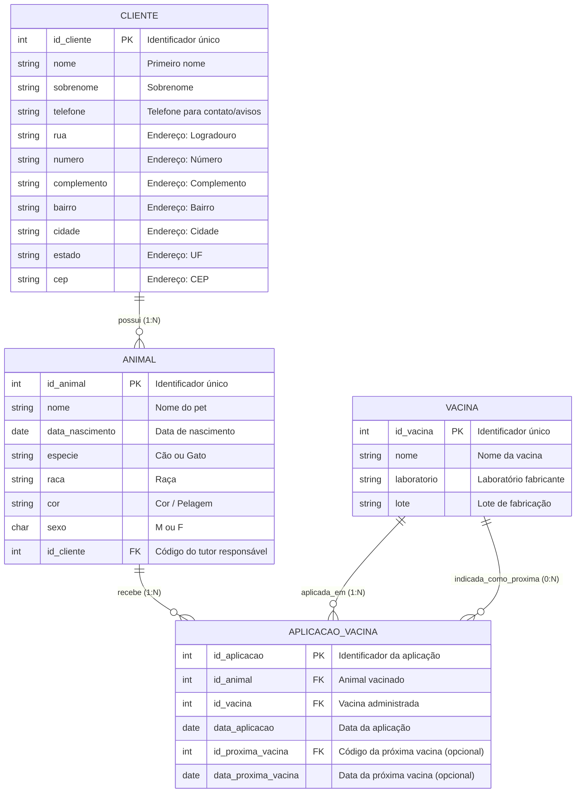

# 🐾 Sistema de Controle de Vacinação e Notificação — Clínica Veterinária
### Modelagem de Banco de Dados Relacional (MER) & Script Físico DDL (T-SQL)

---

## 📌 1. Apresentação do Projeto

Este repositório contém a entrega completa e documentada da **Atividade 01 - Modelagem de Banco de Dados** para uma **Clínica Veterinária** especializada no atendimento de cães e gatos.

O objetivo do sistema é informatizar o controle de vacinas da clínica veterinária, permitindo não apenas o registro histórico das doses administradas, mas principalmente **otimizar a notificação preventiva aos clientes** sobre a data de vencimento e o tipo de vacina a ser aplicada em seus pets.

- **Instituição:** SENAI (Serviço Nacional de Aprendizagem Industrial)
- **Unidade Curricular:** Banco de Dados
- **Docente:** Prof. Tércio B. Ribeiro
- **Data:** 17/11/2026

---

## 🗂️ 2. Estrutura dos Arquivos Entregues

| Arquivo | Descrição |
| :--- | :--- |
| 📄 [`MER_Clinica_Veterinaria.md`](./MER_Clinica_Veterinaria.md) | **Documento Principal do MER:** Descrição conceitual detalhada, dicionário de dados, análise de cardinalidades, regras de negócio e diagramas (Mermaid e ASCII). |
| 🖼️ [`diagrama_mer_clinica.svg`](./diagrama_mer_clinica.svg) | **Diagrama Vetorial (SVG):** Visualização gráfica de alta resolução das entidades, atributos (PK/FK) e relacionamentos. Pode ser aberto em qualquer navegador. |
| 📐 [`diagrama_mer_clinica.drawio`](./diagrama_mer_clinica.drawio) | **Arquivo Editável Draw.io:** Projeto aberto para edição no [diagrams.net](https://app.diagrams.net) ou extensão do VS Code. |
| 💾 [`script_clinica_veterinaria.sql`](./script_clinica_veterinaria.sql) | **Script T-SQL (SQL Server):** DDL completo (`CREATE DATABASE`, `TABLES`, `CONSTRAINTS`, `INDEXES`), carga de dados de teste e consultas SQL para o motor de notificação. |
| 🛡️ [`.gitignore`](./.gitignore) | Configuração de exclusão de artefatos temporários e do PDF original. |

---

## 🧩 3. Diagrama Entidade-Relacionamento (Mermaid)

---

## 🔍 4. Resumo da Modelagem e Regras de Negócio

### 4.1. Entidades e Atributos Identificados
1. **`CLIENTE`**:
   - `id_cliente` (Código numérico / PK).
   - `nome`, `sobrenome`, `telefone`.
   - **Atributo composto `endereco`:** Decomposto em 1ª Forma Normal (1FN) em: `rua`, `numero`, `complemento`, `bairro`, `cidade`, `estado` e `cep`.
2. **`ANIMAL`**:
   - `id_animal` (Código numérico / PK).
   - `nome`, `data_nascimento`, `especie`, `raca`, `cor`, `sexo` (Check: `M` ou `F`).
   - `id_cliente` (FK referenciando `CLIENTE`).
3. **`VACINA`**:
   - `id_vacina` (Código numérico / PK).
   - `nome`, `laboratorio`, `lote`.
4. **`APLICACAO_VACINA`** (Entidade Associativa):
   - `id_aplicacao` (PK da aplicação).
   - `id_animal` (FK -> `ANIMAL`).
   - `id_vacina` (FK -> `VACINA` aplicada).
   - `data_aplicacao` (Data da dose atual).
   - `id_proxima_vacina` (FK -> `VACINA` para o próximo ciclo/reforço).
   - `data_proxima_vacina` (Data planejada para envio da notificação preventiva).

### 4.2. Relacionamentos e Cardinalidades
- **`CLIENTE (1,1) --- possui --- (0,N) ANIMAL`:** Um cliente pode ter vários animais cadastrados na clínica. Cada animal pertence a exatamente um cliente responsável.
- **`ANIMAL (0,N) --- recebe --- (0,N) VACINA`:** Relação muitos-para-muitos resolvida através da entidade associativa `APLICACAO_VACINA`.
- **`APLICACAO_VACINA (0,N) ---> (0,1) VACINA` (`id_proxima_vacina`):** Permite associar a recomendação médica da próxima vacina a ser ministrada, viabilizando o sistema de notificação preventiva exigido no enunciado.

---

## 🚀 5. Como Executar o Script SQL (SQL Server)

1. Abra o **SQL Server Management Studio (SSMS)** ou o **Azure Data Studio**.
2. Conecte-se à sua instância local ou remota do SQL Server.
3. Abra o arquivo [`script_clinica_veterinaria.sql`](./script_clinica_veterinaria.sql).
4. Execute o script (`F5`).
5. O script irá:
   - Criar o banco de dados `ClinicaVeterinaria`.
   - Criar as 4 tabelas com todas as constraints (`PRIMARY KEY`, `FOREIGN KEY`, `CHECK`).
   - Criar índices de performance (incluindo índice filtrado em `data_proxima_vacina`).
   - Inserir dados de teste para clientes, cães, gatos e vacinas.
   - Executar automaticamente a **Query 1** de notificação preditiva de vacinas a vencer.

---

## 📋 6. Matriz de Conformidade com o Enunciado da Atividade

| Item do Enunciado | Atendimento no Projeto | Status |
| :--- | :--- | :---: |
| Informatizar controle de vacinas para cães e gatos | Modelo cobre espécies canina/felina e calendário vacinal | ✅ 100% |
| Notificação de clientes sobre data e tipo de vacina | Implementado via `id_proxima_vacina` e `data_proxima_vacina` | ✅ 100% |
| Cliente: código numérico, nome, sobrenome, telefone | `id_cliente` (PK), `nome`, `sobrenome`, `telefone` | ✅ 100% |
| Endereço completo (rua, num, compl, bairro, cid, UF, CEP) | Colunas normalizadas correspondentes na tabela `CLIENTE` | ✅ 100% |
| Animal: código numérico, nome, nasc, espécie, raça, cor, sexo | `id_animal` (PK), `data_nascimento`, `especie`, `raca`, `cor`, `sexo` | ✅ 100% |
| Vacina: código numérico, nome, fabricante, lote | `id_vacina` (PK), `nome`, `laboratorio`, `lote` | ✅ 100% |
| Registro de vacinação com data de aplicação | Tabela associativa com `data_aplicacao` | ✅ 100% |
| Registro do código da próxima vacina e respectiva data | `id_proxima_vacina` (FK) e `data_proxima_vacina` | ✅ 100% |
| Elaborar MER com entidades, relacionamentos e atributos | Documentação conceitual, física e diagramas | ✅ 100% |

---
**SENAI — 2026**
